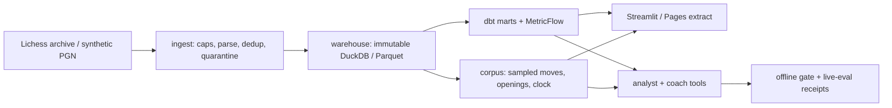

# Chess Analytics Lab

Chess Analytics Lab turns chess game records into reproducible opening, clock-pressure, and move-evaluation analytics. It connects bounded ingestion and immutable DuckDB/Parquet snapshots to dbt contracts, MetricFlow metrics, dashboards, an offline mistake classifier, and tool-calling AI agents. The data and analytics engineering work spans source provenance, metric definitions, publication checks, and evaluations that separate fixture behavior from measured model results. Created by [John (jfk-ssa)](https://github.com/jfk-ssa).

## Live

- Hosted Streamlit dashboard (reads a committed Parquet cube without opening a warehouse): https://chess-analytics-lab.streamlit.app/
- Documentation site: https://jfk-ssa.github.io/chess-analytics-lab/
- Repository: https://github.com/jfk-ssa/chess-analytics-lab

## Architecture



The default offline path runs synthetic PGN through ingestion, snapshot publication, optional dbt marts, metrics, Streamlit, and replayed analyst fixture plans. It requires no API keys. The recurring infrastructure target is $0; paid live-eval runs require personal-account acknowledgement, an explicit USD cap, and the manual `live-eval` environment.

Where: [docs/ARCHITECTURE.md](docs/ARCHITECTURE.md), [src/chess_analytics/ingest/](src/chess_analytics/ingest/), [src/chess_analytics/warehouse/](src/chess_analytics/warehouse/), [src/chess_analytics/marts/](src/chess_analytics/marts/), [src/chess_analytics/corpus/](src/chess_analytics/corpus/), [docs/roadmap/2026-11-de-ai-showcase.md](docs/roadmap/2026-11-de-ai-showcase.md).

## Data engineering

- Bounded ingestion with source hashes, quarantine, and immutable snapshot pointers before publishing any mart or metric.
- Analytical move publication writes `fact_move` from source `%eval` / clock annotations; dbt `move_evals` stages that table for MetricFlow.
- Optional local Dagster and Prefect adapters call the same stage/publish/verify functions. Airflow is a later option, not built here.
- Hosted BI uses a committed Parquet cube rebuilt from warehouse extracts so Streamlit Cloud never opens DuckDB.

Where: [src/chess_analytics/ingest/pipeline.py](src/chess_analytics/ingest/pipeline.py), [src/chess_analytics/warehouse/snapshots.py](src/chess_analytics/warehouse/snapshots.py), [src/chess_analytics/corpus/moves.py](src/chess_analytics/corpus/moves.py), [src/chess_analytics/corpus/publish.py](src/chess_analytics/corpus/publish.py), [dbt/models/marts/move_evals.sql](dbt/models/marts/move_evals.sql), [src/chess_analytics/orchestration/](src/chess_analytics/orchestration/), [docs/ORCHESTRATION.md](docs/ORCHESTRATION.md), [hosted/dashboard.py](hosted/dashboard.py), [docs/HOSTED_DASHBOARD.md](docs/HOSTED_DASHBOARD.md).

## Analytics engineering / semantic layer

- MetricFlow semantic models on `games`, `player_games`, and `move_evals` (dbt-duckdb). Ratio metrics include `game_draw_rate`, `opening_player_score`, `win_rate`, and `mean_centipawn_loss`.
- Analyst `query_metric` compiles governed metrics in-process and falls back to reviewed SQL when the published mart does not match the analytical snapshot.
- JSON contracts define denominators, clamps, and caveats. Accuracy is mean centipawn loss with a 1000 cp per-move clamp; mate transitions are excluded, not zeroed.
- **Next (ADR 0115 later slices):** a shared facade so Streamlit KPI cards and Pages extract receipts resolve the same metric IDs, verified by an offline parity test. Those integrations are not finished.

Where: [dbt/models/marts/_semantic.yml](dbt/models/marts/_semantic.yml), [docs/adr/0085-governed-semantic-layer-metricflow.md](docs/adr/0085-governed-semantic-layer-metricflow.md), [docs/adr/0115-metrics-layer.md](docs/adr/0115-metrics-layer.md), [src/chess_analytics/analyst/semantic.py](src/chess_analytics/analyst/semantic.py), [contracts/mean_centipawn_loss.json](contracts/mean_centipawn_loss.json), [contracts/game_draw_rate.json](contracts/game_draw_rate.json), [docs/METRICS.md](docs/METRICS.md), [docs/DBT_LINEAGE.md](docs/DBT_LINEAGE.md), [dbt/models/exposures.yml](dbt/models/exposures.yml).

## Data quality and contracts

- Versioned metric and table contracts under `contracts/`; dbt models enforce column contracts on marts including `move_evals`.
- dbt unit tests cover eligibility and surrogate-key rules; slim `state:modified+` selection runs in offline CI against the PR base manifest.
- Offline analyst gate replays the deterministic tool stack and fails when the scorecard drifts from the committed baseline (LLM quality is out of scope for that gate).

Where: [contracts/](contracts/), [dbt/models/unit_tests.yml](dbt/models/unit_tests.yml), [docs/adr/0086-dbt-engineering-depth.md](docs/adr/0086-dbt-engineering-depth.md), [src/chess_analytics/analyst/gate.py](src/chess_analytics/analyst/gate.py), [.github/workflows/offline.yml](.github/workflows/offline.yml).

## ML

- Offline mistake classifier (ADR 0116 first slice): `HistGradientBoostingClassifier` predicts the existing `error_proxy` label from pre-move features only. The feature matrix excludes deterioration and post-move evaluations.
- Training frame builder joins `fact_move` / `fact_game`, derives material balance by legal UCI replay, and uses game-id grouped train / calibration / holdout splits. Weights and scored samples are never committed; CI keeps a synthetic fixture only.
- Fixture holdout Brier ≈ 0.0159 at seed 20261031 on 12 synthetic rows. That number measures the synthetic harness only; it does not establish real-corpus accuracy ([docs/MISTAKE_CLASSIFIER.md](docs/MISTAKE_CLASSIFIER.md)).
- **Next:** broader opening-prefix / ECO map, real-corpus evaluation, and the Streamlit risky-positions view (later 0116 slices). Local Maia-3 human-move prediction already exists as a separate checked tool path.

Where: [src/chess_analytics/mistake_training.py](src/chess_analytics/mistake_training.py), [scripts/train_mistake_classifier.py](scripts/train_mistake_classifier.py), [docs/adr/0116-mistake-classifier.md](docs/adr/0116-mistake-classifier.md), [docs/MISTAKE_CLASSIFIER.md](docs/MISTAKE_CLASSIFIER.md), [tests/fixtures/mistake_training.json](tests/fixtures/mistake_training.json), [tests/test_mistake_classifier.py](tests/test_mistake_classifier.py), [pyproject.toml](pyproject.toml) (`ml` extra).

## AI agents and evals

- Typed analyst: allowlisted read-only tools (`query_metric`, `compare_openings`, clock tools, and others), evidence IDs, frozen case sets, offline fixture replay, and a manual live-eval workflow with per-run USD caps and committed receipts.
- Coach package (ADR 0117 first slice): separate offline payload facade, case schema, exact-tool check, and explanation heuristic. Metric allowlist includes `mean_centipawn_loss`. No free-form SQL. Exact / explanation weights reserved at 0.8 / 0.2 for a future combiner.
- Live-eval discipline: frozen file hashes, instructions hash, Doppler-synced secret names `CHESSLAB_OPENAI_API_KEY` and `CHESSLAB_XAI_API_KEY` on the `live-eval` environment only. Offline CI stays secret-free.
- **Next (0117 slices 2–4):** frozen coach question set and warehouse references, a separate live runner with receipt prefix `reports/live-eval-receipt-coach-*.json`, then a first Grok 4.7 run requiring explicit authorization under a $5 USD cap with fixed `gpt-6-luna` as explanation judge. A Sol comparison requires a later authorized dispatch.

Where: [src/chess_analytics/analyst/tools.py](src/chess_analytics/analyst/tools.py), [src/chess_analytics/analyst/live_runner.py](src/chess_analytics/analyst/live_runner.py), [src/chess_analytics/coach/](src/chess_analytics/coach/), [docs/adr/0117-coach-agent-evals.md](docs/adr/0117-coach-agent-evals.md), [tests/fixtures/coach_offline.json](tests/fixtures/coach_offline.json), [docs/EVALUATION.md](docs/EVALUATION.md), [.github/workflows/live-eval.yml](.github/workflows/live-eval.yml), [docs/adr/0114-doppler-secrets-source-of-truth.md](docs/adr/0114-doppler-secrets-source-of-truth.md).

## CI/CD and ops

- Change-aware offline integrity on push/PR: Ruff, basedpyright, Biome, pytest (core / dbt / portfolio / ml / mcp slices), tiny mart transformation, semantic manifest validation, slim dbt selection, offline demo.
- Manual `live-eval` job: `workflow_dispatch` on `main` only, environment approval, input caps (model-specific ceilings), dry-run reservation, receipt artifact upload. Push/PR CI never runs it.
- Pages: `scripts/build_docs_site.py` writes `work/docs-site`; `.github/workflows/pages.yml` uploads that directory and deploys on `main`. dbt docs for the tiny fixture are generated in the same workflow.

Where: [.github/workflows/offline.yml](.github/workflows/offline.yml), [.github/workflows/live-eval.yml](.github/workflows/live-eval.yml), [.github/workflows/pages.yml](.github/workflows/pages.yml), [scripts/build_docs_site.py](scripts/build_docs_site.py), [docs/SITE.md](docs/SITE.md).

## Decisions

Numbered ADRs record accepted choices. Index: [docs/DECISIONS.md](docs/DECISIONS.md). Recent records: [0115 metrics layer](docs/adr/0115-metrics-layer.md), [0116 mistake classifier](docs/adr/0116-mistake-classifier.md), [0117 coach agent + evals](docs/adr/0117-coach-agent-evals.md), roadmap [2026-11 DE / AI showcase](docs/roadmap/2026-11-de-ai-showcase.md). Current checkout summary: [docs/STATUS.md](docs/STATUS.md).

## Run it locally

Prerequisites: Git and [uv](https://docs.astral.sh/uv/). From the repository root (commands from [README.md](README.md)):

```sh
git clone https://github.com/jfk-ssa/chess-analytics-lab.git
cd chess-analytics-lab
uv sync --locked --no-editable --extra dashboard
uv run --locked --offline --no-editable --extra dashboard chesslab demo --scope all
CHESSLAB_PROJECT="$PWD/work/portfolio-demo/project" \
  uv run --locked --offline --no-editable --extra dashboard \
  streamlit run src/chess_analytics/dashboard/dashboard.py
```

Development checks (Ruff, basedpyright, pytest) and the docs-site preview are also in the README and [docs/DEMO.md](docs/DEMO.md) / [docs/SITE.md](docs/SITE.md).
