# dbt lineage

`scripts/render_dbt_dag.py` writes this file from a dbt `manifest.json`.
GitHub renders the diagram below. CI regenerates it and fails if this
copy differs. Arrows point from an upstream node to the node that uses it.

Semantic-model labels end in `semantic` so they stay distinct from the
view of the same name. Metrics sit on those semantic models. Exposures
are the downstream consumers declared in `dbt/models/exposures.yml`.

- Sources: 2
- Staging: 2
- Intermediate: 1
- Marts: 5
- Semantic models: 2
- Metrics: 12
- Exposures: 2

```mermaid
flowchart TD
  subgraph sources["Sources"]
    n_source_chess_analytics_published_fact_game["published.fact_game"]
    n_source_chess_analytics_published_fact_player_game["published.fact_player_game"]
  end
  subgraph staging["Staging"]
    n_model_chess_analytics_stg_games["stg_games"]
    n_model_chess_analytics_stg_player_games["stg_player_games"]
  end
  subgraph intermediate["Intermediate"]
    n_model_chess_analytics_int_game_eligibility["int_game_eligibility"]
  end
  subgraph marts["Marts"]
    n_model_chess_analytics_games["games"]
    n_model_chess_analytics_mart_game_outcomes["mart_game_outcomes"]
    n_model_chess_analytics_mart_player_outcomes["mart_player_outcomes"]
    n_model_chess_analytics_metricflow_time_spine["metricflow_time_spine"]
    n_model_chess_analytics_player_games["player_games"]
  end
  subgraph semantic_models["Semantic models"]
    n_semantic_model_chess_analytics_games["games semantic"]
    n_semantic_model_chess_analytics_player_games["player_games semantic"]
  end
  subgraph metrics["Metrics"]
    n_metric_chess_analytics_drawn_games["drawn_games"]
    n_metric_chess_analytics_eligible_games["eligible_games"]
    n_metric_chess_analytics_game_draw_rate["game_draw_rate"]
    n_metric_chess_analytics_known_opening_games["known_opening_games"]
    n_metric_chess_analytics_opening_draws["opening_draws"]
    n_metric_chess_analytics_opening_losses["opening_losses"]
    n_metric_chess_analytics_opening_player_score["opening_player_score"]
    n_metric_chess_analytics_opening_score_games["opening_score_games"]
    n_metric_chess_analytics_opening_score_total["opening_score_total"]
    n_metric_chess_analytics_opening_wins["opening_wins"]
    n_metric_chess_analytics_unknown_opening_games["unknown_opening_games"]
    n_metric_chess_analytics_win_rate["win_rate"]
  end
  subgraph exposures["Exposures"]
    n_exposure_chess_analytics_governed_metric_analyst["governed_metric_analyst"]
    n_exposure_chess_analytics_portfolio_site["portfolio_site"]
  end
  n_metric_chess_analytics_drawn_games --> n_exposure_chess_analytics_governed_metric_analyst
  n_metric_chess_analytics_drawn_games --> n_metric_chess_analytics_game_draw_rate
  n_metric_chess_analytics_eligible_games --> n_exposure_chess_analytics_governed_metric_analyst
  n_metric_chess_analytics_eligible_games --> n_metric_chess_analytics_game_draw_rate
  n_metric_chess_analytics_game_draw_rate --> n_exposure_chess_analytics_governed_metric_analyst
  n_metric_chess_analytics_known_opening_games --> n_exposure_chess_analytics_governed_metric_analyst
  n_metric_chess_analytics_opening_draws --> n_exposure_chess_analytics_governed_metric_analyst
  n_metric_chess_analytics_opening_losses --> n_exposure_chess_analytics_governed_metric_analyst
  n_metric_chess_analytics_opening_player_score --> n_exposure_chess_analytics_governed_metric_analyst
  n_metric_chess_analytics_opening_score_games --> n_exposure_chess_analytics_governed_metric_analyst
  n_metric_chess_analytics_opening_score_games --> n_metric_chess_analytics_opening_player_score
  n_metric_chess_analytics_opening_score_games --> n_metric_chess_analytics_win_rate
  n_metric_chess_analytics_opening_score_total --> n_exposure_chess_analytics_governed_metric_analyst
  n_metric_chess_analytics_opening_score_total --> n_metric_chess_analytics_opening_player_score
  n_metric_chess_analytics_opening_wins --> n_exposure_chess_analytics_governed_metric_analyst
  n_metric_chess_analytics_opening_wins --> n_metric_chess_analytics_win_rate
  n_metric_chess_analytics_unknown_opening_games --> n_exposure_chess_analytics_governed_metric_analyst
  n_metric_chess_analytics_win_rate --> n_exposure_chess_analytics_governed_metric_analyst
  n_model_chess_analytics_games --> n_exposure_chess_analytics_governed_metric_analyst
  n_model_chess_analytics_games --> n_exposure_chess_analytics_portfolio_site
  n_model_chess_analytics_games --> n_semantic_model_chess_analytics_games
  n_model_chess_analytics_int_game_eligibility --> n_exposure_chess_analytics_portfolio_site
  n_model_chess_analytics_int_game_eligibility --> n_model_chess_analytics_games
  n_model_chess_analytics_int_game_eligibility --> n_model_chess_analytics_mart_game_outcomes
  n_model_chess_analytics_int_game_eligibility --> n_model_chess_analytics_mart_player_outcomes
  n_model_chess_analytics_int_game_eligibility --> n_model_chess_analytics_player_games
  n_model_chess_analytics_mart_game_outcomes --> n_exposure_chess_analytics_portfolio_site
  n_model_chess_analytics_mart_player_outcomes --> n_exposure_chess_analytics_portfolio_site
  n_model_chess_analytics_player_games --> n_exposure_chess_analytics_governed_metric_analyst
  n_model_chess_analytics_player_games --> n_exposure_chess_analytics_portfolio_site
  n_model_chess_analytics_player_games --> n_semantic_model_chess_analytics_player_games
  n_model_chess_analytics_stg_games --> n_exposure_chess_analytics_portfolio_site
  n_model_chess_analytics_stg_games --> n_model_chess_analytics_int_game_eligibility
  n_model_chess_analytics_stg_player_games --> n_exposure_chess_analytics_portfolio_site
  n_model_chess_analytics_stg_player_games --> n_model_chess_analytics_mart_player_outcomes
  n_model_chess_analytics_stg_player_games --> n_model_chess_analytics_player_games
  n_semantic_model_chess_analytics_games --> n_metric_chess_analytics_drawn_games
  n_semantic_model_chess_analytics_games --> n_metric_chess_analytics_eligible_games
  n_semantic_model_chess_analytics_games --> n_metric_chess_analytics_known_opening_games
  n_semantic_model_chess_analytics_games --> n_metric_chess_analytics_unknown_opening_games
  n_semantic_model_chess_analytics_player_games --> n_metric_chess_analytics_opening_draws
  n_semantic_model_chess_analytics_player_games --> n_metric_chess_analytics_opening_losses
  n_semantic_model_chess_analytics_player_games --> n_metric_chess_analytics_opening_score_games
  n_semantic_model_chess_analytics_player_games --> n_metric_chess_analytics_opening_score_total
  n_semantic_model_chess_analytics_player_games --> n_metric_chess_analytics_opening_wins
  n_source_chess_analytics_published_fact_game --> n_model_chess_analytics_stg_games
  n_source_chess_analytics_published_fact_player_game --> n_model_chess_analytics_stg_player_games
```

